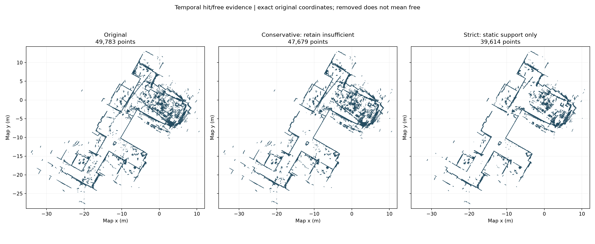

# fin301 camera–LiDAR mapping and temporal filtering

ROS 2/Python indoor mapping using a forward camera and a planar LiDAR. This is the `xinyu` contribution for Intro2AV Project 2.2 using the original **fin301** recording. No IMU, GNSS, supplied odometry/poses or manually drawn map is used.

## View the results

Download/clone this branch and double-click **[OPEN_VIEWER.html](OPEN_VIEWER.html)**. The English viewer works offline without installation or a server, with orbit/pan/zoom, measurement, layer controls and trajectory replay. GitHub's source preview does not execute HTML. `viewer/index.html` is the editable template; use the generated viewer instead.

| Map | Files | LiDAR points |
|---|---|---:|
| Original one-loop reference | [result/](outputs/fin301/result/) | 49,783 |
| Conservative temporal filter | [conservative/result/](outputs/fin301/temporal_filter/conservative/result/) | 47,679 |
| Strict temporal support | [static/result/](outputs/fin301/temporal_filter/static/result/) | 39,614 |

Each directory contains **`map.pcd`, `lidar_scan_map.pcd`, `map.yaml`, `map.pgm`**, coordinate metadata and `trajectory.csv`. Keep YAML and PGM together: the YAML describes the occupancy raster, while `map_metadata.json` describes the PCD. `map.pcd` combines planar LiDAR with 29 camera landmarks. Use **`lidar_scan_map.pcd`** for 2D localization; camera landmarks have their own height and separate layer.

Coordinates are metres in `map`, anchored at the first accepted LiDAR pose; initial x is forward and y left. LiDAR z=0 is the scan plane, not the floor. Vehicle poses account for the recorded mounting transform. Temporal variants preserve every original trajectory timestamp and pose.



## Method and evidence

Robust point-to-line LiDAR registration supplies metric SE(2) motion; the selected graph includes one LiDAR revisit. Calibrated camera images at measurement timestamps produce sparse landmarks through six-view triangulation using LiDAR-derived metric camera poses. Here the camera contributes mapped structure; it did **not** supply an accepted camera pose constraint or demonstrate improved pose accuracy.

The temporal filter evaluates 3,526 accepted scans in 2-second epochs. It distinguishes endpoint support, visible-free contradiction, occlusion and ambiguous/insufficient evidence. A closer object or invalid ray cannot clear a point behind it. Conservative filtering removes 2,104 strong conflicts; strict filtering also removes ambiguous/insufficient support, potentially including genuine structures. Matched grids mask unsupported occupied cells to **unknown**, preserving all previously free/unknown cells.

| Exact exported target | Accepted /800 | All-eight stable queries /100 |
|---|---:|---:|
| Original | 283 | 11 |
| Previous occupancy-supported | 332 | 29 |
| Conservative temporal | 286 | 16 |
| Strict temporal support | 271 | 18 |

These are correlated repeat-observation diagnostics on the same 100 queries and eight starts, not absolute position accuracy. Both gains and failures are retained in the [localization review](outputs/fin301/temporal_filter/validation/temporal_localization_review.md). The previous [occupancy-supported target](outputs/fin301/filtering/lidar_scan_map_clean_occupancy_supported.pcd) remains stronger on these aggregate counts. Stationary people can remain; pose error can resemble temporal change. No independent physical distances/checkpoints were supplied.

- [Temporal method, fixed thresholds and reproduction](outputs/fin301/temporal_filter/temporal_filter_report.md).
- [Group report PDF](outputs/fin301/report/group_technical_report.pdf) / [editable report](outputs/fin301/report/group_technical_report.md): archived one-page draft for the original reconstruction; temporal cleanup is a separate update.
- [Individual contribution template](docs/individual_contribution_template.md): fill only work actually performed; this branch does not establish sole authorship of the whole project.
- [Calibration](outputs/fin301/audit/calibration.json), [references](docs/references.md), [ROS 2 instructions](ROS_RUNTIME.md).

## Run from this directory

Use Python 3.11, create/activate an environment, then:

```bash
python -m pip install -r requirements.txt
python -m pytest -q
node --test tests/viewer_io.test.cjs tests/viewer_renderer.test.cjs
```

Raw ZIP/DB3 files, sensor caches and environments are excluded. Obtain the original `fin301.zip` and extract `data/fin301/fin301_0.db3`; the inherited sibling project also has its own Git LFS restore instructions. Do not substitute its newer recording.

```bash
python scripts/audit_bag.py --bag data/fin301/fin301_0.db3 --output outputs/fin301
python -m indoor_mapping.pipeline --cache outputs/fin301/cache --output outputs/fin301/reproduced_result --lidar-revisits
python scripts/filter_temporal_map.py --result outputs/fin301/reproduced_result --output outputs/fin301/reproduced_temporal
python scripts/export_temporal_map.py --source outputs/fin301/reproduced_result --experiment outputs/fin301/reproduced_temporal
```

These commands create separate result directories. Numerical libraries can introduce small reconstruction differences; archived checksums describe the supplied files, not every rerun. To filter using the archived trajectory, use `--result outputs/fin301/result` instead.

To replay the fixed exported-PCD evaluation after relocation, regenerate the cache above and prepare a **new local** provenance copy:

```bash
python scripts/prepare_local_validation.py
python scripts/evaluate_exported_pcd_candidate.py --baseline-dir outputs/fin301/local_validation --candidate outputs/fin301/temporal_filter/lidar_scan_map_clean_temporal_conservative.pcd --name temporal_conservative
python scripts/evaluate_exported_pcd_candidate.py --baseline-dir outputs/fin301/local_validation --candidate outputs/fin301/temporal_filter/lidar_scan_map_clean_temporal_static.pcd --name temporal_static
```

The helper resolves historical Windows paths to this checkout, verifies frozen source hashes and leaves historical evidence unchanged. Use `--scan-cache /path/to/scans.npz` for an existing exact cache or `--check-only` to verify without writing. If regenerated bytes differ, the strict check fails explicitly; create a new protocol instead of bypassing hashes.

`.gitattributes` preserves recorded bytes. Historical report builders also check filesystem modification times; a fresh checkout may fail that freshness gate even when hashes match. Inspect the supplied report/manifest or perform a complete new reconstruction/report run. The loop-experiment scripts are archived source; their large experimental output sets are not included here. No new ROS execution or physical-accuracy claim is implied by this repository packaging.
