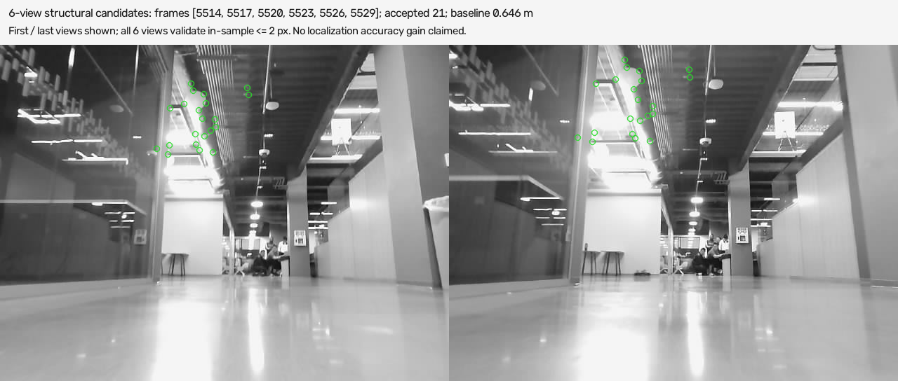

# fin301 / FinTech301 | Indoor Mapping

Group: [enter group ID]

Source recording: `data/fin301/fin301_0.db3`.

**DRAFT - Internal evaluation; physical-reference validation incomplete.**

Estimated duration: 591.8 / 591.9 s (100.0% of raw-scan span).

## Scope

Offline reconstruction uses the supplied physical-car ROS 2 bag: a monocular RGB camera and raw planar LiDAR. No IMU, GNSS, magnetometer, wheel/recorded odometry, recorded poses, dynamic TF or recorded map enters estimation. The supplied recording is used as received; this report makes no claim of new data collection.

## Inputs and time alignment

The bag contains 17,628 raw scans (29.78 Hz, 1,440 rays) and 5,879 compressed RGB frames (10.00 Hz, 640x480); 2 images fail decoding. Raw stamps have 0 duplicates and 0 reversals in recording order. The separate /scan stream has 0 duplicate stamps and 0 conflicting range arrays; it is excluded. RGB starts 3.03 s after raw LiDAR; initial scans have no camera observation. Integer header timestamps [1] support nearest-image association within 50 ms. Across all RGB frames, nearest-raw-scan error median/p95/max is 8.40/15.85/17.23 ms; 100.0% are within 50 ms. This is timestamp alignment, not hardware synchronization.

## Estimation pipeline

Raw LiDAR uses robust point-to-line ICP against a local submap; invalid or degenerate matches are rejected. Camera revisit proposals require ORB/RANSAC and reciprocal LiDAR verification. This run accepts no camera loop constraint; camera does not update poses. Separate camera mapping tracks features through six frames, undistorts recorded K/D and triangulates the first/last pair using LiDAR-derived metric camera poses and static extrinsics [2]. Depth/range, baseline, parallax, forward-backward flow and reprojection checks in all six views provide in-sample screening. The combined map retains both sources; camera points do not independently validate the LiDAR trajectory. Upward world-ray filtering selects structural candidates; no arbitrary world-height cutoff is applied. 1 separately verified LiDAR revisit edge(s) correct the SE(2) trajectory [3]. Maximum graph correction is 1.498 m; it is not a measured absolute-error reduction. An engineering problem was that valid-normal support did not measure actual scan overlap. Separate geometric coverage, reciprocal registration and neighboring-scan checks support conservative partial-overlap revisits.

## Coordinate frame and calibration

The local origin is the first accepted LiDAR pose: x forward, y left, metres; z=0 is the scan-plane projection. Recorded base-to-laser xyz=(-0.08256, -0.01723, 0.03410) m. Recorded base-to-camera xyz=(0.12323, -0.01723, -0.05339) m. Recorded planar mounting converts laser poses to vehicle poses. Full rotations and intrinsics are in calibration.json; physical calibration remains unverified. Visual heights are relative to the initial LiDAR scan plane under planar vehicle motion.

## Measured output: internal consistency only

| Measure | Current result |
|---|---:|
| Tracked duration / bag span | 591.8 / 591.9 s |
| LiDAR / camera candidate points | 49,783 / 29 |
| Accepted LiDAR / camera revisits | 1 / 0 |
| Held-out accepted starts | 712 / 800 |
| All starts agree / queries | 71 / 100 |
| Within-query spread p95: m / deg | 0.009 / 0.18 |
| Accepted fit median / p95 (mm) | 14.7 / 71.0 |
| Earlier-pass stable / queries | 11 / 20 |

## Development validation with held-out scans

Development validation: 100 raw-scan queries are absent from all odometry/map insertion stamps. Each uses eight fixed initial perturbations (0.25/0.50 m and 5/10 degrees); references exclude scans within 5 s or 0.5 m and contain LiDAR returns only. 712/800 registrations pass the fixed fit gates; 71/100 queries have all eight starts accepted and agree within 0.15 m / 3 degrees. The p95 maximum within-query pose spread is 0.009 m / 0.18 degrees among 92 queries with at least two accepted solutions; failures remain in the acceptance denominator. Earlier-pass references (at least 30 s earlier) yield 11/20 stable queries. Query/reference IDs and initial poses are frozen for comparisons. Estimated baseline poses define selection and starting priors, not ground truth. These are internal robustness measures, not absolute localization accuracy; the same queries informed method selection and are not an untouched final test set. Frozen-protocol comparison: accepted starts 707 to 712 / 800; stable queries 67 to 71 / 100; position-spread p95 0.528 to 0.009 m. Selection uses this same internal test; generalization and absolute accuracy remain unvalidated.


## Camera diagnostic and limits

Earlier four-view diagnostic: only 10/93 landmarks pass the 2 px prediction gate in both additional frames with frozen XYZ and trajectory. The selected 6-view method uses its construction views for in-sample screening; those views are not a new held-out test. Camera landmarks do not correct poses or establish localization improvement.


## Export and inspection

map.pcd is PCD 0.7 ASCII XYZ in metres [4]: LiDAR scan-plane points (z=0) plus triangulated camera XYZ. Use lidar_scan_map.pcd or LiDAR occupancy for 2D localization; visual_landmarks.pcd is a separate experimental component. Do not project visual XYZ into a 2D localization map. The combined map is for source inspection, not validated 3D navigation. Open with PCL pcl_viewer or CloudCompare with PCD support.


Development validation: green means all eight initializations agree; red means a rejected or inconsistent start. Queries are held out from odometry, but used for method selection. Positions are estimated.



Camera candidate landmarks: 29 XYZ points after 6-view in-sample screening. Not a loop closure, independent height reference or demonstrated localization improvement.

## Limits and missing experiment

Visual reprojection and ICP residuals are internal consistency measures, not independent 3D or pose accuracy. Planar-motion, recorded calibration, moving objects, low texture and uncompensated scan motion limit reliability. **Physical-reference validation remains incomplete; no reference provided.** Measured walls, landmarks or an independent trajectory are needed; no centimetre-accuracy claim is supported.

## Reproducibility

Evidence: `outputs/fin301/audit/audit.json`; `outputs/fin301/result/metrics.json`, `loop_events.json`, `trajectory_arrays.npz`, and `map.pcd`.

```text
.venv/Scripts/python.exe scripts/build_report.py --result "outputs/fin301/result" --audit "outputs/fin301/audit/audit.json" --output "outputs/fin301/report" --dataset-name "fin301 / FinTech301" --notes-output "docs/report_notes_fin301_zh.md" --strict --runtime-evidence "outputs/fin301/verification/ros_final_artifacts_test.txt" --localization-evidence "outputs/fin301/verification/localization_final/localization_evaluation.json" --camera-validation-evidence "outputs/fin301/verification/visual_landmark_review_heldout.json"
```

Evaluation evidence: `outputs/fin301/verification/localization_final/localization_evaluation.json`; `outputs/fin301/verification/visual_landmark_review_heldout.json`.

## References

1. [ROS 2 LaserScan / timestamp and axes](https://github.com/ros2/common_interfaces/blob/rolling/sensor_msgs/msg/LaserScan.msg)
2. [OpenCV / camera geometry and triangulation](https://docs.opencv.org/4.x/d9/d0c/group__calib3d.html)
3. [SciPy / nonlinear least squares](https://docs.scipy.org/doc/scipy/reference/generated/scipy.optimize.least_squares.html)
4. [PCL / PCD file format](https://pointclouds.org/documentation/tutorials/pcd_file_format.html)
