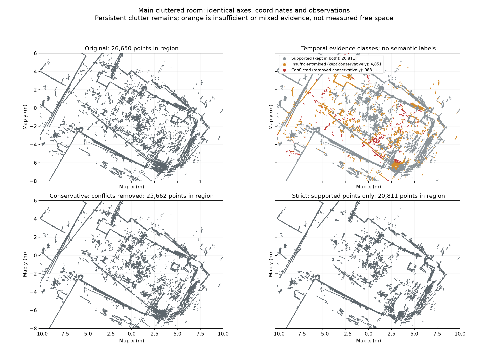

# Independent temporal-filter review

The saved conservative mask implements the declared visibility rule and retains every insufficient point. This is evidence consistency under the estimated trajectory, not semantic detection or proof that every removed point moved.

Independent checks passed:

- Recomputed hit, free and occluded epoch counts for all 49,783 original points, and reproduced both classification masks.
- Verified conservative 47,679-point and strict 39,614-point PCDs are exact original ASCII-row subsets. Source, evidence and candidate hashes match.
- Recomputed eight first/last hit/free events directly from raw ranges and estimated poses for points 35291 and 4968. Every event agrees. Free cases require finite valid rays throughout the angular fan and at least 0.20 m clearance beyond the candidate range.
- Four focused tests pass. Closer or invalid neighboring rays block free votes; hit evidence overrides free within an epoch. Actual supporting timestamps determine duration gates.
- All 3,526 accepted evidence scan IDs, timestamps and poses align with the saved original result. They exclude the 100 main and 20 earlier-pass evaluation query IDs, but every main query is within 0.069 s of an evidence scan. Exact-PCD evaluation remains temporally correlated.

## Main cluttered room



All four views use x = [-10, 10] m and y = [-8, 6] m. The original region has 26,650 points. Conservative filtering removes 988 (3.71%), leaving 25,662. Strict support-only selection leaves 20,811, removing 5,839 (21.91%). The 4,851 orange points in this region remain in the conservative map.

Substantial dense/disordered structure remains in both filtered views. Red conflicts include coherent straight segments; orange evidence also follows long boundaries. These can include estimated-pose inconsistency, reflective surfaces, changing objects or limited visibility. The map image alone cannot distinguish those causes or establish a false-removal rate. Thin structures and entire boundaries must not be labelled dynamic solely because the strict output omits them.

Across the complete map, 966 of the 2,104 removed conflict points have at least three hit epochs; 365 have at least five and 58 have at least ten. Conversely, 5,094 of the 8,065 insufficient points have at least three hit epochs over ten seconds, but fail the strict free-fraction criterion. “Insufficient” therefore includes mixed repeated evidence, not just rarely seen points.

## Concrete ray examples

Point 35291 at (0.392, -4.401) m has 14 hit and 35 free epochs. Hits at 58.932 and 91.671 s are within 0.012 and 0.016 m of measured endpoints. Free observations at 104.601 and 225.987 s have minimum fan returns of 6.471 and 4.105 m for point ranges of 4.749 and 2.691 m. The later contradictory observations are real under the estimated poses; their semantic cause is unknown.

Point 4968 at (-19.120, -20.894) m has five hit and twelve free epochs. Its first/last hits occur at 504.872 and 529.721 s; its first/last free observations are at 472.801 and 552.216 s. This mixed timeline cautions against equating frequent hit support with permanence, or equating removed points with people. The nearest hit at 529.721 s occurs only 0.147 m from the estimated LiDAR origin, where the forward camera cannot be assumed to observe the same surface.

The three timestamped [photographic sequences](visual_evidence.md) show changing human posture alongside persistent stools, and a moving camera beside a person/doorway. They provide scene context, not point-to-person labels. Camera disappearance, invalid ranges, lack of coverage and occlusion are not measured free space.

Keep original occupancy semantics: removing PCD points does not turn their cells into free occupancy cells. Localization comparisons must retain failures in the denominator and remain labelled development repeat-observation stability. This review makes no claim of absolute accuracy improvement and does not choose a default candidate before those results.

Reproduce the numerical output review and room plot with:

```powershell
.venv/Scripts/python.exe outputs/fin301/temporal_filter/visual_audit/review_temporal_output.py
```

`independent_temporal_review.json` records the checks and raw-ray values. `observation_input_audit.json` records input alignment and near-time correlation. The original result and filter outputs were read only.
