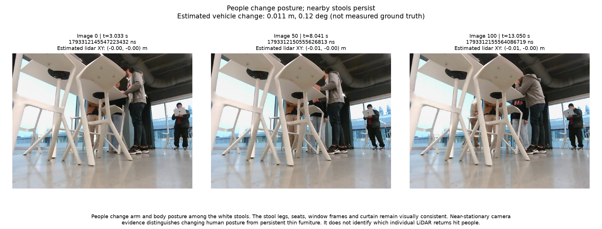
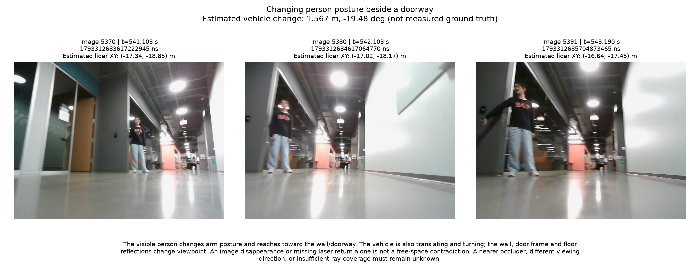
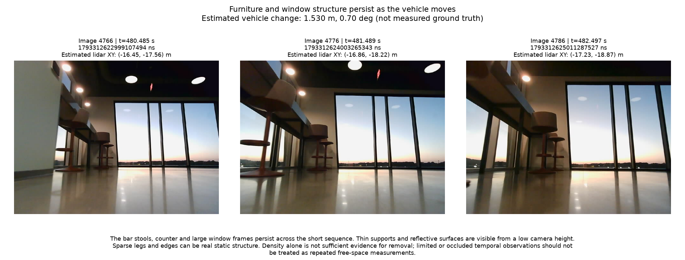

# Photographic context for temporal filtering

People and persistent furniture coexist in these recordings. The examples support using repeated observations and actual free-space contradictions, rather than treating low density as proof of motion.

| Sequence | Image IDs | Elapsed times (s) | Estimated vehicle displacement |
|---|---|---|---:|
| People change posture; nearby stools persist | 0 / 50 / 100 | 3.033 / 8.041 / 13.050 | 0.011 m |
| Changing person posture beside a doorway | 5370 / 5380 / 5391 | 541.103 / 542.103 / 543.190 | 1.567 m |
| Furniture and window structure persist as the vehicle moves | 4766 / 4776 / 4786 | 480.485 / 481.489 / 482.497 | 1.530 m |

**People change posture; nearby stools persist**

People change arm and body posture among the white stools. The stool legs, seats, window frames and curtain remain visually consistent. Near-stationary camera evidence distinguishes changing human posture from persistent thin furniture. It does not identify which individual LiDAR returns hit people.

**Changing person posture beside a doorway**

The visible person changes arm posture and reaches toward the wall/doorway. The vehicle is also translating and turning; the wall, door frame and floor reflections change viewpoint. An image disappearance or missing laser return alone is not a free-space contradiction. A nearer occluder, different viewing direction, or insufficient ray coverage must remain unknown.

**Furniture and window structure persist as the vehicle moves**

The bar stools, counter and large window frames persist across the short sequence. Thin supports and reflective surfaces are visible from a low camera height. Sparse legs and edges can be real static structure. Density alone is not sufficient evidence for removal; limited or occluded temporal observations should not be treated as repeated free-space measurements.

Limits:

- Qualitative human review of recorded photographs, not an automated person/object detector.
- Camera field of view and height differ from the 360-degree laser scan plane. No removed LiDAR point is semantically labelled here.
- Vehicle poses and interpolated image-time positions are estimates, not independent physical truth.
- A moving person may remain still long enough to pass persistence checks; an observed static object may later move.
- No image absence, occlusion, invalid range or unobserved direction should be counted as observed free space.
- This audit does not claim that temporal filtering improves localization; paired frozen-query evaluation remains necessary.

The JSON records exact header timestamps, nearest raw-scan IDs/deltas, image hashes and original map/trajectory provenance. Source photographs and original map files remain unchanged.

Reproduce with `.venv/Scripts/python.exe scripts/audit_temporal_evidence.py`.
